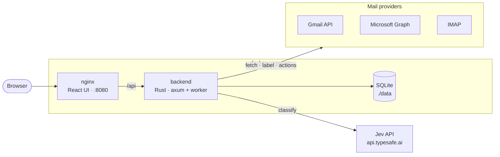

# jev email labeller

Self-hosted email triage with TypeSafe's [Jev](https://docs.typesafe.ai) model. A Rust worker polls your mailboxes. For each new message it asks Jev one `choice` question: which of your labels fits best? It applies the label only when Jev is confident enough. A React UI lets you manage labels, rules, accounts and past decisions.

- **Gmail** (OAuth, native labels), **Outlook / Microsoft 365** (OAuth, categories) and **any IMAP** mailbox (keywords, or `Jev/<label>` folders as a fallback)
- **Dry-run by default.** Decisions are recorded, and mailboxes are untouched until you turn dry-run off, globally or per account.
- **Threshold:** the label is applied only if Jev's top probability is at least the threshold (default 0.7, can be set per label). Otherwise the email gets **Review**.
- **Never deletes.** The mail provider interface has no delete or trash operation. Optional rules (archive, mark read, move, star) need p ≥ 0.9.
- **Processed once:** each message id is recorded, so nothing is classified twice.
- **Playground** for testing label descriptions against sample emails without touching a mailbox



## Quick start

```sh
cp .env.example .env        # set ADMIN_PASSWORD, APP_SECRET, JEV_API_KEY
mkdir -p data               # Linux only: sudo chown 10001:10001 data
docker compose up -d --build
```

Open http://localhost:8080 and sign in with `ADMIN_PASSWORD`. Then:

1. **Labels**: adjust the seeded labels. The description is what Jev reads, so be specific.
2. **Playground**: paste a few real emails and check the decisions.
3. **Accounts**: add a mailbox. It starts in dry-run.
4. **Classifications**: review the dry-run decisions. Use *Apply to mailbox* for single messages, *Change label* to correct one, or *Re-classify* after editing labels.
5. **Settings**: turn off global dry-run (and the account's own dry-run) when you trust it.
6. **Rules** (optional): e.g. archive Promos when Jev is ≥ 95% sure.

### Try it without a real mailbox

`compose.dev.yaml` adds a [GreenMail](https://greenmail-mail-test.github.io/greenmail/) test server:

```sh
docker compose -f compose.yaml -f compose.dev.yaml up -d --build
```

Add an IMAP account with host `greenmail`, port `3143`, security *None*, username `me@example.test` and any password. Then send mail to `me@example.test` via SMTP on `localhost:3025` (see the comment in `compose.dev.yaml`).

## Connecting providers

### IMAP (Fastmail, iCloud, Yahoo, Proton Mail Bridge, …)

No registration needed. Use an app password where your provider supports one.

- Labels are stored as IMAP keywords (`$Jev_Needs_reply`) if the server allows custom flags. Many clients show these as tags; Thunderbird does, for example.
- Otherwise the message is **copied** to `Jev/<label>`. Folder copies can't be removed when you change a label, because that would mean deleting mail.
- *Archive* and *Move* need the server to support `MOVE`.
- For Proton Mail Bridge, use STARTTLS on port 1143 and turn on *Accept self-signed certificate*.

### Gmail

1. In [Google Cloud Console](https://console.cloud.google.com/), create a project and enable the **Gmail API**.
2. Configure the OAuth consent screen. "External" plus your address as a test user is fine for personal use. Add the scope `https://www.googleapis.com/auth/gmail.modify`.
3. Create an **OAuth client ID** of type *Web application* with this redirect URI:
   `${PUBLIC_URL}/api/oauth/google/callback` (e.g. `http://localhost:8080/api/oauth/google/callback`)
4. Put the ID and secret in `.env` as `GOOGLE_CLIENT_ID` / `GOOGLE_CLIENT_SECRET`, then restart.
5. **Accounts → Add account → Gmail → Continue to Gmail.**

`gmail.modify` lets the app read mail and change labels. The app never calls Gmail's trash or delete endpoints.

### Outlook / Microsoft 365

1. In the [Entra admin center](https://entra.microsoft.com/), go to **App registrations → New registration**.
   - Supported account types: pick what you need. *Any org directory + personal accounts* matches `MS_TENANT=common`.
   - Redirect URI: platform *Web*, `${PUBLIC_URL}/api/oauth/microsoft/callback`
2. **Certificates & secrets → New client secret.**
3. **API permissions:** add Microsoft Graph delegated permissions `Mail.ReadWrite`, `MailboxSettings.ReadWrite`, `User.Read` and `offline_access`.
4. Set `MS_CLIENT_ID`, `MS_CLIENT_SECRET` (and `MS_TENANT` if needed) in `.env`, then restart.
5. **Accounts → Add account → Outlook.**

Labels become Outlook **categories**. Archive moves the message to the Archive folder. The app requests immutable message ids, so later corrections still work after a move.

## Configuration

Environment variables (see `.env.example`):

| Variable | Default | |
|---|---|---|
| `ADMIN_PASSWORD` | — | **required.** Web UI password. |
| `APP_SECRET` | — | **required.** 16+ chars. Encrypts stored passwords and tokens (ChaCha20-Poly1305). |
| `JEV_API_KEY` | — | TypeSafe API key. Without it, classification fails with a clear error. |
| `PUBLIC_URL` | `http://localhost:8080` | Base URL for OAuth redirects. |
| `JEV_MODEL` / `JEV_BASE_URL` | `jev-latest` / `https://api.typesafe.ai` | |
| `DEFAULT_THRESHOLD`, `BODY_CHARS`, `DRY_RUN` | `0.7`, `2000`, `true` | Starting values for the Settings page. |
| `GOOGLE_CLIENT_ID/SECRET`, `MS_CLIENT_ID/SECRET/TENANT` | — | OAuth apps. |
| `COOKIE_SECURE` | `true` if `PUBLIC_URL` is https | |
| `PORT` | `8080` | Host port for the UI (compose). |

Everything else lives in the database and is edited in the UI: threshold, body length, max messages per poll, the Jev question instructions, and dry-run.

### How a message is handled

1. The worker lists new inbox messages since the account's cursor (the last 7 days on first run) and skips ids it has already recorded.
2. Jev receives `From`, `Subject` and the first `BODY_CHARS` characters of the plain-text body (HTML is converted), plus one `choice` question with the enabled labels as options.
3. The top label wins if its probability is at least the label's threshold (or the global one). Otherwise the label is **Review**.
4. In dry-run, the decision is only recorded. Otherwise the label is applied, then any matching rules run (p ≥ max(rule minimum, 0.9); star and mark-read first; at most one archive or move).
5. The result is stored in `classifications`.

Jev or network errors stop the poll, and it is retried at the next interval. The account card shows the error.

## Development

```sh
# backend (http://127.0.0.1:18080)
cd backend
DATA_DIR=../data ADMIN_PASSWORD=dev APP_SECRET=dev-secret-123456 BIND=127.0.0.1:18080 cargo run
cargo test && cargo clippy --all-targets -- -D warnings

# frontend (http://localhost:5173, proxies /api to :18080)
cd frontend
npm install && npm run dev
npm run build && npm run lint
```

- **Backend:** Rust (axum, tokio, sqlx/SQLite, reqwest + rustls, async-imap, mail-parser).
- **Frontend:** React 19, Vite, Tailwind v4, shadcn/ui (Radix), TanStack Query, react-hook-form + zod, Poppins.
